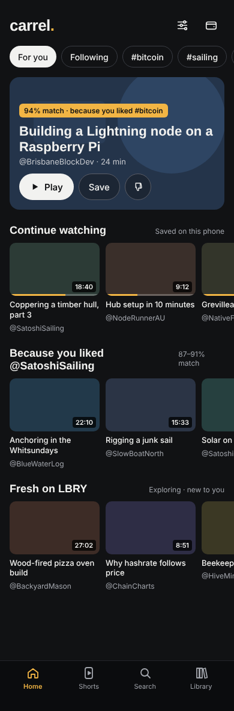
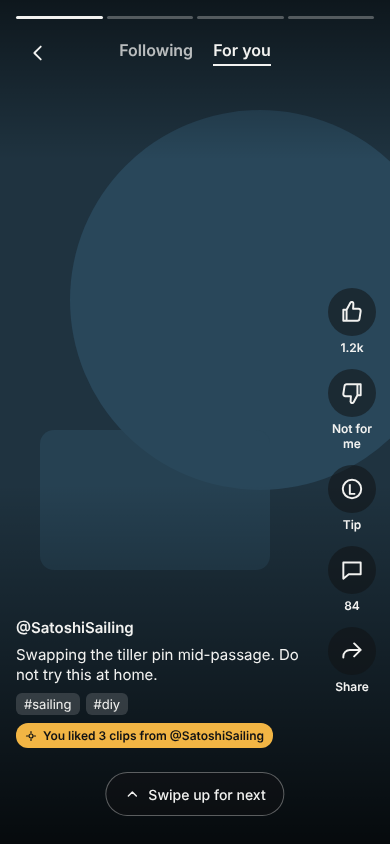
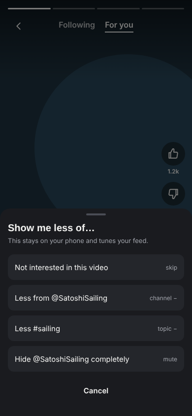
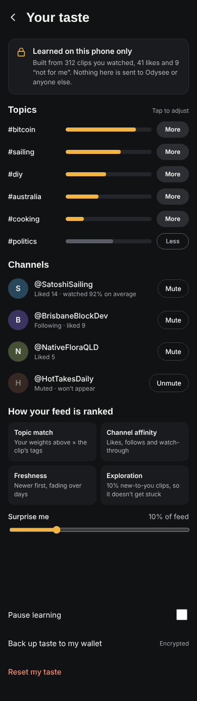

# Carrel

A native iOS client for the LBRY network — a fast, self-custodial alternative to Odysee.

- **Native and fast** — SwiftUI, AVPlayer, picture-in-picture, background audio, offline downloads, `lbry://` deep links.
- **Self-custodial** — your keys live on your phone, in an embedded light wallet. No hosted account.
- **Not dependent on Odysee** — starts on Odysee's public SDK proxy for convenience, moves to our own node.

## Status

Day-one scaffold: Discover (trending), Search (Lighthouse full-text plus pasted `lbry://` / odysee.com links), and playback via the SDK's `get` → `streaming_url`. Library is a placeholder.

## Screens

Mock-ups from the design canvas ("Carrel mock screens"). Real screenshots will go in [`docs/screenshots/`](docs/screenshots/) as the app comes together.

| Home · For you | Shorts | Not for me | Your taste |
|:---:|:---:|:---:|:---:|
|  |  |  |  |

## Getting started

```sh
brew install xcodegen
xcodegen            # generates Carrel.xcodeproj from project.yml
open Carrel.xcodeproj
```

`LBRYKit` is a local Swift package and can be tested on its own:

```sh
cd Packages/LBRYKit && swift test
```

## Layout

```
Carrel/                 SwiftUI app (iOS 17+)
  CarrelApp.swift       App entry, AppModel, tabs, deep-link handling
  Model/                Taste persistence, streaming-URL prefetch cache
  Views/                Discover, Shorts, Search, Library, Your taste, claim row + detail/player
Packages/LBRYKit/       Pure-Swift LBRY client
  LBRYClient.swift      JSON-RPC client: resolve, claim_search, get, Lighthouse search
  Models.swift          Claim, ChannelRef, ClaimValue, Page, ClaimSearchParams
  LBRYURL.swift         Normalise lbry:// and odysee.com links
  ContentFilter.swift   On-device tag/channel/claim filter (App Store Guideline 1.2)
  Recommend/            TasteProfile (signals → weights), FeedRanker (scoring + exploration), ShortsFeed
  Chain/                CarrelChain: headers, LBRY PoW, retarget, rolling window, hub client, sync
  Wallet/               Phrases, BIP32, addresses, transactions, signing, scan, iCloud Keychain vault
  Text/                 Linkifier for descriptions (URLs, X, Reddit, LBRY channels)
scripts/
  make_checkpoint.py    Generates the shipped mainnet checkpoint from a live hub
project.yml             XcodeGen spec
```

## Architecture

```
 Carrel (iOS)
 ├── LBRYKit ── JSON-RPC ──► lbrynet daemon   (Odysee proxy now → carrel-node later)
 │           └─ HTTPS ─────► Lighthouse search
 ├── AVPlayer ─ HTTP ──────► streaming_url    (Odysee CDN now → our seeding node later)
 └── CarrelChain (planned) ─ hub protocol ──► LBRY hubs
```

Things that look like "LBRY" but are really Odysee's own servers, and how we handle them:

| Piece | Today | Plan |
|---|---|---|
| Metadata (`resolve`, `claim_search`) | Odysee SDK proxy | Our lbrynet + hub (`carrel-node`) |
| Video blobs | Odysee reflectors / CDN | Seeding node that caches what our users watch |
| Search | Odysee Lighthouse | Self-hosted Lighthouse or hub search |
| Comments, reactions, view counts | Odysee comment server / API (read-only) | Own comment server, or channel-signed comments |
| Accounts / sync | Not used | Wallet import (seed or keys) instead of Odysee login |

## Recommendations (on device)

Shorts is ranked by `FeedRanker` against a `TasteProfile` that never leaves the phone:

```
score = 1.0·topicMatch + 0.8·channelAffinity + 0.4·freshness
```

- **Signals:** like +0.25 topics / +0.30 channel, watched to the end +0.10, skipped within 2 s −0.06, "not interested" −0.15 / −0.10. Explicit "less of" choices push −0.6; "hide channel" mutes it. Weights are clamped to ±1, and a topic push is spread over the clip's tags.
- **Exploration:** every *n*-th slot (default 10%, "Surprise me" slider 0–40%) is a random clip the viewer has no opinion on yet, so the feed doesn't narrow.
- **Candidates:** up to three `claim_search` queries per page (trending, top liked channels, top topics), all filtered to `duration <=180`. Only these broad interests reach the server; ranking and the profile stay local.
- **Your taste** (Library tab) shows topics and channels with their weights, lets you hide or unmute them, change the surprise share, pause learning or reset.

The mock screens are on the "Carrel mock screens" design canvas.

## Wallet

Self-custodial LBC, built into LBRYKit (`Sources/LBRYKit/Wallet`, `Chain`).

**Keys.** A new wallet gets a 12-word BIP39 phrase. The seed is derived the LBRY SDK way (PBKDF2, salt `lbryum`) with receive addresses at `m/0/i` and change at `m/1/i`, so a phrase from LBRY Desktop or Odysee restores here and vice versa. xprv and xpub (watch-only) import work too.

**Backup.** `SeedVault` keeps the phrase in the Keychain as a synchronizable item, so iCloud Keychain carries it end-to-end encrypted to a new iPhone with nothing to write down (Breez-style). "Show recovery phrase" stays available for an offline copy. Trade-off: whoever controls the Apple ID can restore the wallet, so larger balances should get a nudge towards the offline copy.

**Balance and history.** `Wallet.scan()` walks addresses until a gap of 20 unused receive (6 change), fetches each transaction once from a hub (`blockchain.address.get_history`, `transaction.get_batch`), and works out coins as outputs paying us minus those our own transactions spend. Support and tip outputs paying us are kept apart from spendable coins.

**Verification (CarrelChain).** The app keeps a rolling window of the last 100 headers, checked from a shipped checkpoint (`Checkpoint+Mainnet.swift`, regenerate with `scripts/make_checkpoint.py`): prev-hash linkage, LBRY's per-block retarget and LBRY's proof of work. When a wallet transaction's block is inside that window, its merkle proof must match our own header or the scan fails; older history is taken from the hub. Headers also commit to the claimtrie root, so verified `resolve` is possible later.

**Spending.** Sends, tips (a support output paying the creator) and supports (paying yourself) use the same coin selection, fees (50 dewies/byte), legacy P2PKH signing and pre-broadcast signature self-check as lbc.exchange. Signing goes through Bitcoin Core's libsecp256k1 (RFC 6979, low-S). The tests check the Swift output byte-for-byte against transactions built by the bridge's TypeScript wallet.

**Still to do:** wallet screens (balance, receive QR, send, Tip button in Shorts), first-run create/restore flow, and the encrypted taste-profile backup keyed from the wallet seed.

## Roadmap

1. Browse, search, channels, playback *(scaffolded)*
2. Library: local subscriptions, history, downloads, PiP, background audio
3. **Shorts-style feed** *(built)* — full-screen vertical clips ≤3 min, swipe for more, like / not for me, next two prefetched
4. **"For you" rows** — Netflix-style rails on the Discover tab, reusing the same ranker

5. CarrelChain + wallet: checkpoint sync, keys, scan, tip/support/send *(core built)*; screens next
6. `carrel-node`: own lbrynet, hub, seeding node, comment server, moderation list
7. Publishing from the phone

## App Store notes

- **Guideline 1.2 (UGC):** report, block and filter are required. `ContentFilter` is the on-device layer; a server-side list follows.
- **Crypto:** wallet apps must ship from an organisation developer account. Tipping in LBC is the part most likely to draw in-app-purchase questions.
